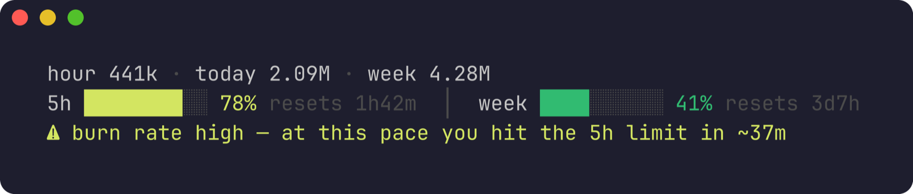
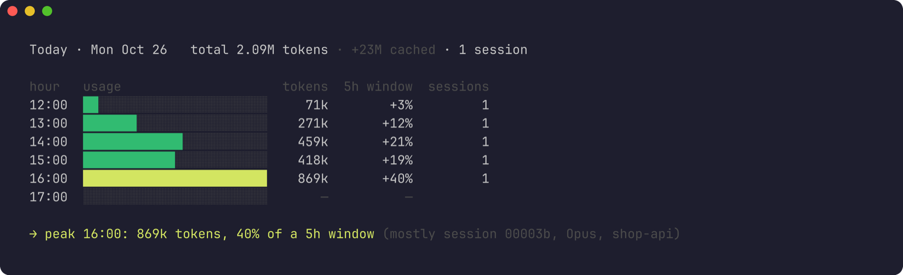
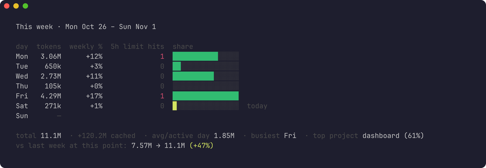
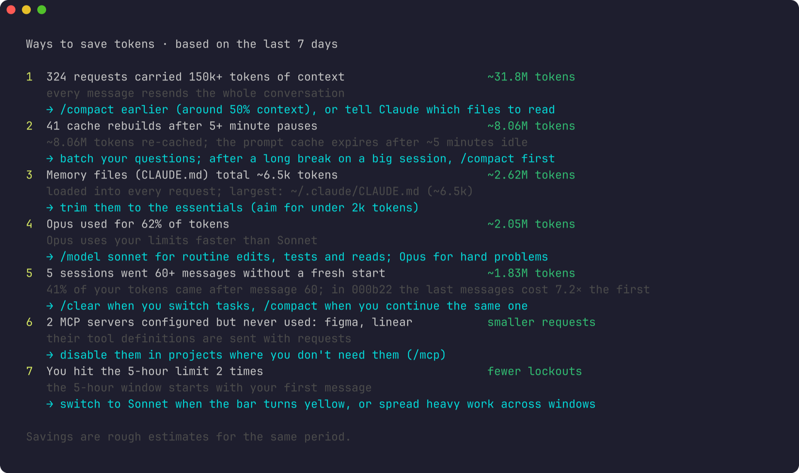

<div align="center">

# pacr

**Know how many tokens you're burning in Claude Code — and how close you are to your limits.**

Per hour, day, week and session · 5-hour and weekly limits · burn rate · smart tips · alerts

[](https://github.com/byadityaraj/pacr/actions/workflows/test.yml)
[](LICENSE)




</div>

## Features

- **Live status line** in Claude Code: tokens this hour, today and this week, plus your 5-hour and weekly limits with reset countdowns.
- **Burn-rate warning** before you hit a limit, and close to it the one action that saves the most right now: `/compact`, `/model sonnet` or `/clear`.
- **Reports** by hour, day, week, month, session and git branch, plus a heatmap of when you burn the most.
- **Tips from your own data**: long sessions, oversized `CLAUDE.md`, unused MCP servers, cache rebuilds after idle pauses.
- **Alerts** as desktop and editor notifications: limit thresholds, burn rate, your own budget, and "window reset — you're good to go".
- **VS Code, Cursor, Windsurf and VSCodium** status bar with a full report panel.
- **Private**: reads local logs only. No network calls, never touches your login.

## Quick start

Requires [Node.js 18+](https://nodejs.org) and [Claude Code](https://code.claude.com).

```bash
npm install -g github:byadityaraj/pacr
pacr install
```

Start a new Claude Code session. The status line appears at the bottom, and `/pacr` works inside Claude Code.

Check the setup any time with `pacr doctor`.

## Screenshots

| Today, hour by hour | This week |
|---|---|
|  |  |

| Ways to save tokens | VS Code status bar |
|---|---|
|  |  |

## Installation

### 1. Install the CLI

**macOS / Linux**

```bash
npm install -g github:byadityaraj/pacr
```

<details>
<summary>Getting <code>EACCES</code> permission errors?</summary>

Your npm global folder is owned by root. Fix it once (don't use `sudo npm`):

```bash
sudo chown -R $(id -u):$(id -g) "$(npm config get prefix)" ~/.npm
```
</details>

**Windows** (PowerShell or Command Prompt)

```powershell
npm install -g github:byadityaraj/pacr
```

WSL works too. Install pacr inside WSL if you run Claude Code there.

### 2. Connect it to Claude Code

```bash
pacr install
```

This adds the pacr status line and the `/pacr` command to Claude Code. Your existing status line is backed up and restored by `pacr uninstall`. Start a new Claude Code session to see it.

### 3. Add it to your editor (optional)

1. Download `pacr-x.y.z.vsix` from [Releases](https://github.com/byadityaraj/pacr/releases/latest).
2. Install it:

   ```bash
   code --install-extension pacr-0.1.0.vsix       # VS Code
   cursor --install-extension pacr-0.1.0.vsix     # Cursor
   windsurf --install-extension pacr-0.1.0.vsix   # Windsurf
   codium --install-extension pacr-0.1.0.vsix     # VSCodium
   ```

   Or in the editor: **Extensions → ⋯ → Install from VSIX…**
3. Reload the window. pacr appears in the status bar; click it for the full report.

It works whether you run Claude Code in the terminal or in the Claude Code extension panel.

## Usage

### Inside Claude Code

| Type | What happens |
|---|---|
| `/pacr` | Shows your usage, and Claude points out what stands out |
| `/pacr week`, `/pacr tips` … | Any pacr command, with a short comment from Claude |
| `! pacr today` | Runs pacr directly, with no model call |

### In the terminal

| Command | Shows |
|---|---|
| `pacr` | Tokens and limits right now |
| `pacr today` · `pacr yesterday` · `pacr day 2026-11-03` | Hour by hour, with the peak hour and the session behind it |
| `pacr week [--last]` | Day by day, weekly limit projection, comparison with last week |
| `pacr month [--last]` | Week by week, top projects and branches, comparison with last month |
| `pacr sessions` · `pacr session <id>` | Heaviest sessions and why; one session's full timeline |
| `pacr branches` | Tokens per git branch — what a feature actually cost |
| `pacr heatmap` | When in the week you burn the most |
| `pacr tips` | Ranked ways to save tokens, from your own data |
| `pacr plan` | Limit hits, time spent waiting for resets, whether your plan fits |
| `pacr summary` | Last week on one screen |
| `pacr alerts` | Alert settings and recent alerts (`pacr alerts test` sends one) |
| `pacr budget daily 3M` | Set your own daily or weekly token budget |
| `pacr export --csv` | Raw data for Excel or Sheets |

Run `pacr help` for every option.

## Alerts

Each alert fires once per window, day or session, as a desktop notification and in your editor:

- 5-hour limit at 90%, weekly limit at 80% and 90%
- Burn rate: on pace to hit the 5-hour limit within 45 minutes
- A window you maxed out has reset
- Your own budget at 80% and 100%
- One session passes $5 (estimated)
- Once a week, from Monday: last week's summary

Test them with `pacr alerts test`.

## Configuration

```bash
pacr config                         # show all settings
pacr config notify.weekly 70,90     # change one
```

<details>
<summary>All settings</summary>

| Key | Default | Meaning |
|---|---|---|
| `warnPct` / `dangerPct` | `70` / `90` | Status line turns yellow / red at this limit % |
| `countCacheReads` | `false` | `true` includes cache reads in totals (matches ccusage) |
| `budget.daily` / `budget.weekly` | off | Your own token budgets (easier with `pacr budget`) |
| `notify.enabled` | `true` | Desktop notifications on or off |
| `notify.fiveHour` | `90` | Notify when the 5-hour window crosses these % |
| `notify.weekly` | `80,90` | Notify when the weekly window crosses these % |
| `notify.burnRate` / `notify.burnMinutes` | `true` / `45` | Warn when on pace to hit the 5-hour limit within N minutes |
| `notify.resetReady` | `true` | Tell you when a maxed-out window resets |
| `notify.budget` | `true` | Notify at 80% and 100% of your budget |
| `notify.sessionCostUsd` | `5` | Nudge when one session passes this estimated cost (`null` = off) |
| `notify.weeklySummary` | `true` | Last week's summary, once a week from Monday |

Settings are stored in `~/.pacr/config.json`. Editor settings are under `pacr.*`.
</details>

## How it works

- **Tokens** come from Claude Code's local session logs in `~/.claude/projects`. Totals count fresh tokens (input, output and cache writes). Cache reads are shown separately because they're usually over 90% of the raw number but count far less toward your limits.
- **Limit percentages** come from the data Claude Code passes to its status line. They're available on Pro and Max plans. pacr never guesses token caps per plan.
- **History**: Claude Code doesn't keep a history of limit percentages, so pacr saves a snapshot about once a minute while you work. Burn rate, limit-hit history and `pacr plan` get more accurate after a few days.
- **Fast**: the status line reads only new log data, so each refresh adds a few tens of milliseconds on top of Node's start-up.

Claude Code deletes logs older than 30 days by default (`cleanupPeriodDays` in `~/.claude/settings.json`), so reports can't go back further than that unless you raise it.

## Privacy

- Reads Claude Code's local logs and settings only.
- Writes only to `~/.pacr`, plus the status line and `/pacr` command when you run `pacr install`.
- **No network calls. Never reads your login token or credentials.**

## Troubleshooting

Run `pacr doctor` first. It checks each piece and says what's missing.

<details>
<summary>Common problems</summary>

| Problem | Fix |
|---|---|
| Status line doesn't appear | Start a new Claude Code session, then run `pacr doctor` |
| No limit percentages | They appear after the first reply in a Pro or Max session. API-key logins don't have them |
| `/pacr` missing | Run `pacr install` again, then start a new session |
| No desktop notifications | Run `pacr alerts test`. macOS: allow notifications for Script Editor in System Settings. Linux: install `notify-send` (libnotify) |
| Hard to read on a light terminal | pacr uses your terminal's colours. Also pick a light theme in Claude Code with `/theme` |
</details>

## Uninstall

```bash
pacr uninstall          # removes the status line and /pacr, restores your previous status line
npm uninstall -g pacr
```

Delete `~/.pacr` to remove pacr's saved data.

## Contributing

Issues and pull requests are welcome.

```bash
git clone https://github.com/byadityaraj/pacr && cd pacr
npm link        # puts your checkout on PATH as `pacr`
npm test
```

pacr has no dependencies; please keep it that way. The status line is the hot path: it must stay fast, never print to stderr and never exit with an error.

## License

[MIT](LICENSE). pacr is an independent project, not affiliated with Anthropic. "Claude" and "Claude Code" are trademarks of Anthropic. Costs shown are Claude Code's own estimates at API list prices.
